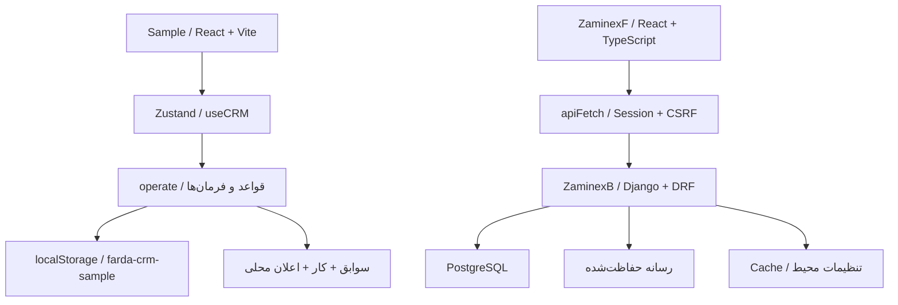
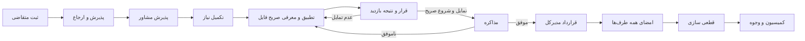

# راهنمای برنامه‌نویس CRM املاک فردا — Sample و تطبیق با Zaminex

تاریخ بررسی: ۲۰ اکتبر ۲۰۲۶ / ۲۸ مهر ۱۴۰۵. محل تحویل: فقط پوشه `Sample`.

## چگونه این بسته را بخوانیم؟

1. همین سند: معماری، صفحات، قواعد و گردش‌کارها، اختلاف‌ها و برنامه اجرا.
2. [پیوست شواهد کد](SOURCE-INVENTORY.fa.md): موجودیت‌ها و فیلدهای واقعی Django، URLها، actionها، مسیر صفحات فرانت‌اند و تغییرات نسبت به HEAD با ارجاع خط.
3. [قراردادهای هدف و فرهنگ داده](TARGET-CONTRACTS.fa.md): شرح صفحه‌به‌صفحهٔ کاتالوگ فعلی Sample، مدل‌های پیشنهادی و ورودی/خروجی فرمان‌ها. این پیوست قرارداد طراحی است؛ وجود API یا جدول را ثابت نمی‌کند.

نام واقعی پوشه بک‌اند `ZaminexB` است؛ `ZaminesB` در درخواست به همین پوشه تفسیر شده است. فرانت‌اند متصل به Django در `ZaminexF` و نمونه مستقل محصول در `Sample` قرار دارد. این سه یکی نیستند. در این نوبت فقط سند ایجاد شده؛ هیچ قابلیت بک‌اند یا رابطی پیاده نشده است.

### سطح اعتبار ادعاها

| برچسب | معنای دقیق |
|---|---|
| موجود در کد | تعریف، کنترل یا مسیر در checkout فعلی دیده شد؛ لزوماً اجرا یا منتشر نشده |
| موجود در Sample | منطق در مرورگر و داده ساختگی است؛ تضمین سرور یا چندکاربره نیست |
| تغییر نسبت به HEAD | اختلاف فایل فعلی با آخرین commit محلی؛ نویسنده و استقرار آن احراز نشده |
| هدف / پیشنهادی | نیاز محصول یا قرارداد طراحی؛ برای اجرا باید مدل، سرویس، API و آزمون ساخته شود |
| نیازمند تأیید اجرایی | نیاز به اجرای برنامه، بررسی دیتابیس، migration یا محیط انتشار دارد |

بازبینی حاضر ایستا است. سرور، مرورگر، دیتابیس، پیامک و تست‌های محصول اجرا نشده‌اند. از فایل SQL پشتیبان، اطلاعات اشخاص، رمزها و تنظیمات محرمانه در سند استفاده نشده است. فهرست فیلدها از کد استخراج شده، نه از دیتابیس زنده. وجود migration اثبات اجرای migration نیست.

### اصلاح یک خطای مهم در اسناد قبلی

`Sample/DEVELOPER_HANDOFF.md` و بعضی متن‌های `developerGuide` از مبنای قدیمی استفاده می‌کنند و وجود اشخاص، درخواست ثبت ملک و حوزه‌های مدیریتی را به بک‌اند نسبت می‌دهند. در مدل‌های واقعی checkout فعلی، `Contact`، `PropertyRegistrationRequest`، `ManagementScope`، `ScopeMembership`، `AssignmentHistory`، `Inquiry`، `Introduction`، `Viewing`، `Deal` و `Contract` یافت نشدند. آنچه واقعاً وجود دارد `User`، `Role`، `RolePermission`، `SalesRange`، `Property`، `Listing`، `PropertyAppraisalReport`، `FollowUp`، `Task`، تیکت، اعلان، لاگ و اطلاعات پایه است. نام‌های مشابه مفهومی جای مدل واقعی را نمی‌گیرند. برای اختلاف با متن‌های قدیمی، تطبیق این بسته با کد روز مرجع است.

## فهرست مطالعه

- بخش‌های ۱ تا ۳: معماری، موجودیت و دسترسی.
- بخش‌های ۴ و ۵: قواعد مشترک و شرح ۲۸ صفحه/نمای عملیاتی.
- بخش‌های ۶ تا ۸: چرخه کامل ملک، عرضه، متقاضی، معامله و وضعیت‌ها.
- بخش‌های ۹ و ۱۰: تغییرهای واقعی backend و فاصله با هدف.
- بخش‌های ۱۱ تا ۱۳: برنامه اجرا، معیار پذیرش و محدودیت بررسی.

## ۱. معماری و مرزها

بین Sample و Django اتصال API وجود ندارد. مسیرهای `/api/v1/...` در کاتالوگ صرفاً طرح پیشنهادی‌اند. در ZaminexF هم مسیر API یکسان و سراسری `/api/v1` نداریم؛ برای مثال ملک از `/properties/api/properties/` خوانده می‌شود.

### معماری Sample

- `src/main.jsx`: ورود React و روتر؛ `src/App.jsx`: پوسته، مسیرها، خواندن query و فرم‌های عمومی.
- `src/features/PropertyFlowWizard.jsx` و `InquiryFlowWizard.jsx`: ادامه همان پرونده در مراحل نقش‌محور. فهرست‌ها در `PropertyRequestsList.jsx`.
- `src/features/IntakeWorkspace.jsx`: تصمیم‌های کارتابل؛ `PipelineWorkspace.jsx`: دو کاریز؛ `SecondaryPages.jsx`: کارکنان، کارها، مالی، گزارش و تنظیمات.
- `src/store/useCRM.js`: seed، بازیابی نسخه، تعویض کاربر نمایشی، busy، خطا و ذخیره محلی. کلید `farda-crm-sample` است. شکست ذخیره‌سازی هشدار دارد؛ داده نامعتبر قبلی نباید بی‌صدا بازنویسی شود.
- `src/services/operations.js`: مرز تغییر دامنه؛ `operate(original, actorId, action, payload)` از کپی داده شروع می‌کند. ورودی، دسترسی و روابط را کنترل و در پایان نتیجه و سوابق می‌سازد. شکست قبل از تحویل db جدید نباید تغییر جزئی را وارد store کند.
- `intake.js`: دسترسی صفحه، عضویت، پذیرش، ارجاع، انصراف و تمدید؛ `action-availability.js`: مجازبودن فرم/دکمه با توجه به مرحله؛ `property-listings.js`: مسئول و تأیید واقعی ملک و فایل؛ `collaboration.js`: همکاری دو مشاور.
- `property-wizard.js` و `inquiry-wizard.js`: مرجع مرحله نمایشی فعلی. `pipelines.js` شامل تعریف‌های قدیمی‌تر هم هست؛ مرحله ویزارد را از روی یک مقدار status ساده بازسازی نکنید.
- `src/mock/seed.js`: داده نمایشی و ساختار collectionها؛ `src/types/models.js` و `features/developerGuide/models.js`: شرح طرح و قرارداد، نه مدل پایگاه داده.

در فرمان‌های محلی، `operation_id`، امضای مرتب‌شده درخواست و کاربر برای تشخیص تکرار استفاده می‌شوند. درخواست تکراری با همان شناسه و بدنه باید به نتیجه قبلی برگردد و با بدنه/کاربر متفاوت رد شود. این رفتار در مرورگر معادل قفل دیتابیس و تراکنش توزیع‌شده نیست.

### معماری نسخه متصل

`ZaminexB/config/urls.py` درخواست‌های `/app/...` را به `config/views.py:dashboard` می‌رساند؛ view نیازمند ورود است و initial data را از `accounts/presentation.py` می‌سازد. React در `ZaminexF/src/app/App.tsx` صفحه را با `shared/lib/appRouting.ts` انتخاب می‌کند. `shared/lib/navPages.ts` منو و `permissions.tsx` نمایش مجاز صفحات را تعیین می‌کنند.

`apiClient.ts` کوکی نشست و CSRF را می‌فرستد، خطای فیلدها را خوانا می‌کند و انقضای نشست را مدیریت می‌کند. قرارداد پاسخ واقعی هر endpoint را از serializer و view همان endpoint بخوانید؛ envelope پیشنهادی Sample را به آن تحمیل نکنید.

فایل `ZaminexF/vite.config.ts` خروجی build را داخل `ZaminexB/static/frontend` می‌نویسد و `emptyOutDir` فعال است. بنابراین build فرانت‌اند عملیاتی، اقدام صرفاً خواندنی نیست. این بررسی آن را اجرا نکرده است. نسخه‌های اظهارشده: React 18.3.1، Vite 6.3.5، Django 5.2.16 و DRF 3.17.1؛ این اعداد از manifestها هستند و نسخه نصب‌شده یا سرویس زنده را اثبات نمی‌کنند.

## ۲. واژه‌نامه و موجودیت‌ها

| مفهوم | مسئولیت و رابطه | وضعیت فعلی |
|---|---|---|
| User / گروه / پروفایل | هویت ورود، مجوز عمل، اطلاعات کارمند سه مفهوم جدا | Sample گروه‌های چندگانه دارد؛ Django هنوز `User.role` و RolePermission دارد |
| رنج | دامنه کاری؛ اجازه دیدن داده از اجازه عمل جداست | Sample: scopes و memberships تاریخی؛ Django: SalesRange با managers/members |
| شخص | یک انسان با چند نقش مالک/متقاضی/طرف معامله و شماره‌های تماس | Sample: contacts/contactPhones؛ Django: مشخصات مالک داخل Property و نام مخاطب داخل FollowUp |
| سرنخ | ثبت اولیه برای شروع پرونده ملک یا متقاضی؛ ثبت‌کننده الزاماً مسئول نیست | در Sample پرونده و شخص می‌سازد؛ مدل مستقل Lead در Django نیست |
| درخواست ثبت ملک | فرایند تأمین و کارشناسی، پذیرش و ارجاع؛ به ملک نتیجه می‌دهد | registrationRequests محلی؛ Django مدل مستقل ندارد |
| ملک | دارایی فیزیکی، نشانی، مساحت، نوع، مدارک، مالکیت و تأیید کارشناسی | Property در هر دو، ولی فیلدها و ماشین وضعیت متفاوت‌اند |
| فایل عرضه / Listing | پیشنهاد تجاری روی ملک برای نوع معامله مشخص؛ قیمت متعلق به فایل است | هر دو دارند؛ یکتایی زوج ملک/نوع و حذف تأیید مستقل فایل فقط در هدف Sample |
| نیاز متقاضی | بودجه، نوع معامله، مناطق، شروط ضروری و مسئول رسیدگی | inquiries/preferences/criteria محلی؛ Django ندارد |
| معرفی | پیوند دقیق یک نیاز و یک فایل با snapshot شرایط و دو مشاور | محلی؛ Django ندارد |
| بازدید مشتری | قرار و نتیجه مربوط به همان معرفی؛ با کارشناسی اولیه فرق دارد | محلی؛ Task نوع VIEWING در Django جای مدل مستقل Viewing نیست |
| مذاکره | مسیر تجاری همان متقاضی و فایل؛ موفق یا ناموفق | deals و dealParticipants محلی؛ Django ندارد |
| قرارداد | شرایط قطعی، طرفین، امضا، پیوست، نسخه و اصلاحیه | فقط mock؛ تیکت و فایل PDF جای قرارداد نیستند |
| کمیسیون | طلب از هر طرف قرارداد و سهم ذی‌نفعان | محلی؛ backend دفتر کمیسیون ندارد |
| وجه / تخصیص | دریافت/پرداخت و مصرف هر مبلغ روی طلب یا سهم | محلی؛ حسابداری و درگاه واقعی نیست |
| کار / پیگیری | کار اجرایی با مسئول و موعد؛ پیگیری دارای نتیجه تماس/اقدام | هر دو دارند؛ مدل‌های Django عمدتاً به Property وصل‌اند |
| سوابق | تغییر مرحله، ارجاع، جابه‌جایی رنج، تصمیم و تمدید | Sample collectionهای جدا؛ Django ActivityLog عمومی دارد |

داده‌های ملک فیزیکی را برای هر آگهی تکرار نکنید. بودجه‌های فروش و اجاره را با یک عدد مشترک جایگزین نکنید. مبلغ معامله، کمیسیون مصوب، وجه وصول‌شده و سهم پرداخت‌شده چهار شاخص متفاوت‌اند.

## ۳. دسترسی‌ها: رفتار موجود و قرارداد هدف

### در Sample

`canOpenPage` دسترسی صفحه، `canAccess` دسترسی رکورد، و فرمان `operate` اجازه تغییر را کنترل می‌کنند. گروه‌های اصلی `GENERAL_MANAGER`، `RANGE_MANAGER`، `AGENT` و نقش مالی `FINANCE` هستند. شناسه‌های نقش قدیمی مانند `CONTRACT_OFFICER` هنوز ممکن است در داده/کد دیده شوند، اما قراردادها در ورودی `canAccess` برای همه جز مدیرکل مسدودند.

| عمل | مدیرکل | مدیر رنج | مشاور | مالی |
|---|---|---|---|---|
| پذیرش اولیه | همه | رنج با عضویت MANAGER فعال | خیر | خیر |
| ارجاع | همه | رنج خودش با شرایط تعویض | خیر | خیر |
| پذیرش ارجاع | قاعده کلی گروه مدیرکل را هم می‌پذیرد، ولی مسئول همان actor باید باشد | صرف مدیریت کافی نیست | فقط مسئول فعلی | خیر |
| تکمیل کارشناسی | دسترسی ویژه مدیرکل | صرف مدیریت مجوز مالکیت عملیاتی نیست | مسئول پذیرفته‌شده | خیر |
| تعیین عنوان / تأیید ملک | بله | رنج خودش | عنوان فقط خواندنی | خیر |
| ثبت فایل عرضه | بله با مسئول فعال معتبر | فقط اگر مالک عملیات مجاز باشد | مالک فعلی ملک تأییدشده | خیر |
| مشاهده اکسپلور | فایل فعال و معتبر | همان | همان | تابع مجوز صفحه |
| معرفی و هماهنگی | مجاز بر اساس فرمان | حوزه مجاز | رابطه متقاضی/ملک | خیر |
| قرارداد، امضا و اصلاحیه | فقط این گروه | خیر | خیر | خیر |
| وجوه | بله | تنها در صورت مجوز/رابطه معتبر | مجوز عمومی ندارد | مجوز مالی |

ثبت‌کننده سرنخ را برای همیشه صاحب پرونده نکنید. پیش از پذیرش و پس از تغییر مسئول باید دسترسی عملیاتی دوباره محاسبه شود. مشاور سمت ملک باید بتواند همکاری در معرفی و بازدید را ببیند، بدون ورود به پرونده خصوصی متقاضی مشاور دیگر. نمایش اطلاعات قابل عرضه مجوز دیدن شماره مالک، نشانی خصوصی یا ویرایش ملک نیست.

### در Django فعلی

`accounts/permissions.py:permission_codes_for_user` نقش `User.role` را به `Role.permissions` وصل می‌کند؛ ADMIN مجوز کامل دارد. وجود `groups` ارث‌برده‌شده از AbstractUser به معنی استفاده از گروه‌های Django به‌عنوان مرجع فعلی نیست.

`accounts/scoping.py:team_user_ids` برای مدیر کل مقدار نامحدود، برای مدیر رنج اعضای رنج‌های فعال تحت مدیریت به‌علاوه خودش و برای مشاور فقط خودش را برمی‌گرداند. این طراحی مبتنی بر «کاربر مسئول» است؛ شناسه رنج پرونده و تاریخچه عضویت مستقل ندارد. تغییر عضویت می‌تواند دامنه رؤیت پرونده‌های قدیمی را هم تغییر دهد. انتقال پرونده بین رنج‌ها نباید با جابه‌جایی کارمند یکی فرض شود.

مجوزهای واقعی مثل `property.assign`، `property.review`، `listing.review`، `task.manage` و `consultant.manage` در `permission_catalog.py` تعریف شده‌اند. API ماتریس دسترسی و رنج واقعاً در URLها وجود دارد؛ اما گروه‌های چندگانه Sample هنوز قرارداد backend نیستند.

برای پیاده‌سازی هدف، کنترل باید روی فهرست، جزئیات، فرمان، جست‌وجو، شمارنده، گزارش و فایل رسانه یکسان باشد. مستند رسمی DRF نیز تصریح می‌کند کنترل object به‌تنهایی فهرست و create را پوشش نمی‌دهد؛ محدودسازی queryset و کنترل ساخت لازم است: [مجوزهای DRF](https://github.com/encode/django-rest-framework/blob/main/docs/api-guide/permissions.md). این نکته از Context7 بازیابی شده؛ تأیید اجرای سیاست در تمام endpointهای فعلی نیست.

## ۴. قواعد مشترک صفحات Sample

هر صفحه عملیاتی باید از مجموعه داده مجاز همان کاربر استفاده کند. نبود دسترسی نباید با شناسه URL یا query ساختگی دور زده شود. `App.jsx` مسیر را از pathname و فرم را از query می‌خواند؛ ویزاردها و پنل‌های پرونده نیز queryهای خود را دارند. باقی‌ماندن فرم بعد از refresh باید برای هر فرم جدا بررسی شود؛ صرف استفاده از Router این تضمین را برای همه فرم‌ها نمی‌دهد.

فیلتر، صفحه‌بندی، پنل سوابق و فرم فرزند را مستقل نگه دارید. بستن فرم زمان بازدید، بازدید ذخیره‌شده را لغو نمی‌کند. بستن فرم فرزند نباید پنل سوابق یا پرونده والد را ببندد. لینک فایل عرضه از پرونده در تب جدید باز می‌شود تا مرحله پرونده باقی بماند. نمایش مرحله صرفاً ابزار راهنماست و نباید به‌تنهایی وضعیت تجاری را تغییر دهد.

شرح زیر رفتار فعلی و نقاط اتصال هدف را جدا می‌کند. نام فرمان JavaScript به معنی وجود endpoint هم‌نام در Django نیست. نمونه کامل ورودی/خروجی هدف و شروط پذیرش هر صفحه در پیوست قراردادها آمده است.

## ۵. راهنمای صفحه‌به‌صفحه Sample

### ۵.۱ نمای کلی — `/dashboard`

هدف: کاربر بداند امروز چه چیزی نیازمند اقدام است. UI در `App.jsx` شامل آمار، کارهای جاری و مسیر ادامه پرونده‌هاست. وابستگی‌ها: `tasks`، `registrationRequests`، `inquiries`، `listings` و رکوردهای مالی مجاز. رویداد اصلی کلیک روی کارت/کار و رفتن به همان پرونده است؛ داشبورد محل تغییر مستقیم مرحله نیست. همه گروه‌های فعال می‌توانند وارد شوند ولی شاخص‌ها باید محدود به داده مجاز باشند. API هدف `dashboard` و `reports`؛ معادل فعلی backend از خانواده `/common/api/analytics/...` است و معیارهای آن با mock یکسان نیست.

### ۵.۲ ثبت اولیه ملک — `/property-register`

هدف: ایجاد پرونده با حداقل اطلاعات و ادامه همان شناسه تا عرضه. UI: مراحل ثبت، پذیرش مدیر، ارجاع، پذیرش مشاور، کارشناسی، تأیید ملک و فایل عرضه. اجزا: `PropertyFlowWizard`، `PropertyRegistrationWizard` و خدمات `property-wizard.js`. رویداد `createLead` پرونده PROPERTY و اطلاعات تماس می‌سازد؛ ثبت مدیر مسئول پذیرش مجدد نمی‌خواهد، ثبت مشاور کار پذیرش مدیر رنج می‌سازد. پیش از ثبت پرونده مراحل بعد فقط توضیح وضعیت‌اند؛ نقش نامرتبط نباید اقدام آینده را ببیند. API واقعی backend برای این پرونده اولیه وجود ندارد؛ `POST /properties/api/properties/draft/` پیش‌نویس Property است و معادل پذیرش و ارجاع پرونده نیست.

### ۵.۳ ثبت سرنخ سازگار — `/lead-submit` و مسیر قدیمی `/leads`

`IntakeWorkspace` فرم اولیه را نگه می‌دارد. مشاور با عضویت فعال فقط در رنج خود می‌سازد؛ مدیر در حوزه مجاز. فرمان `createLead` بر اساس PROPERTY یا INQUIRY پرونده مربوط را می‌سازد. `/leads` فهرست مستقل فعلی نیست؛ در App به `/inbox` و در حالت `action=createLead` به `/lead-submit` هدایت می‌شود. حذف صفحه، حذف داده و سابقه نیست. API کاتالوگ `/api/v1/leads` پیشنهادی است؛ مدل یا endpoint Lead در Django فعلی یافت نشد.

### ۵.۴ کارتابل پذیرش — `/inbox`

هدف: صف تصمیم‌هایی که همین actor باید بگیرد. UI: کارت وضعیت، نام پرونده، مسئول، خلاصه، اقدام اصلی و سوابق؛ فرم تصمیم انصراف در مودال. داده از `isInAcceptanceInbox` و دسترسی جاری انتخاب می‌شود. پذیرش اولیه و تأیید ملک/تمدید/انصراف برای مدیر مجاز است؛ کارت منتظر پذیرش ارجاع فقط برای همان مشاور نمایش می‌یابد. پرونده آماده ارجاع بدون تصمیم معلق در این صفحه نیست؛ ارجاع در مرحله ارجاع جزئیات انجام می‌شود.

رویدادها: `acceptLead`، `acceptAssignment`، `reviewProperty`، `reviewConsultantWithdrawal`، `approveAssignmentExtension` و `rejectAssignmentExtension`. وجود `assignCase` در کاتالوگ قدیمی این صفحه به معنی وجود دکمه ارجاع فعلی در inbox نیست. وابسته به پرونده، property review، rescheduleHistory، کارها و اعلان‌ها. در Django فعلی فقط بخش تأیید/رد Property و Listing endpoint واقعی دارد؛ صف یکپارچه و تصمیم پذیرش ارجاع وجود ندارد.

### ۵.۵ فهرست پرونده‌های ملک — `/requests`

`PropertyRequestsList` کارت‌های جمع‌وجور، هفت فیلتر مرحله، جست‌وجو، شمارش، مسئول مرحله، صفحه‌بندی، وضعیت، سوابق و کار/پیگیری مودالی را نمایش می‌دهد. مرحله صفرنتیجه هم باید قابل انتخاب باشد. مجموعه فهرست فقط پرونده‌های پذیرفته‌شده نیست؛ پذیرش اولیه و ارجاع نیز در آن حضور دارند. فرمان ایجاد به `/property-register` می‌رود؛ کلیک ادامه به `/requests/{id}`. گروه دارای مجوز registration و دامنه مجاز می‌بیند؛ برای بررسی مدیر باید عضویت مدیریتی همان رنج وجود داشته باشد. Django صفحه و مدل درخواست ثبت مستقل ندارد؛ فهرست Property جایگزین مستقیم آن نیست.

### ۵.۶ جزئیات و فضای کارشناسی — `/requests/{id}`

ویزارد همان پرونده، مسئول مرحله و اقدام بعدی را نشان می‌دهد؛ `view=history` مسیر سازگار نمایش قدیمی را نگه می‌دارد. UI: شرح اولیه، عنوان مدیریتی، تماس، مشخصات ملک، کارشناسی، فایل‌های عرضه، وضعیت تمدید و سوابق. `saveWorkspace` مشخصات ملک و گزارش را روی همان پرونده ذخیره می‌کند؛ مشاور عنوان را تغییر نمی‌دهد. `setPropertyTitle` برای مدیر، `submitPropertyForReview` برای مسئول پذیرفته‌شده و `reviewProperty` برای مدیر حوزه است. `markDuplicateCase` و `reopenAppraisal` با دلیل و حفظ تاریخچه اجرا می‌شوند. پیوند `resulting_property_id` باید ثابت بماند و ثبت مجدد نباید Property دوم بسازد.

فایل‌ها: `PropertyFlowWizard.jsx`، `PropertyWorkspace.jsx`، `PropertyCasePanels.jsx`، `PropertyHistoryModal.jsx`، `CaseExtensionStatus.jsx` و `operations.js`. داده‌ها: registrationRequests، properties، appraisals، listings و سوابق. API هدف اختصاصی درخواست/کارشناسی لازم است؛ backend فقط CRUD ملک، پیش‌نویس و PDF کارشناسی دارد.

### ۵.۷ بررسی مدیر — `/reviews` و تصمیم در کارتابل

هدف تصمیم درباره خود ملک و گزارش همان نسخه است. صف/نمای سازگار در App و عملیات جاری در کارتابل به هم متصل‌اند؛ نباید آن را صف تأیید مستقل Listing معرفی کرد. مدیر عنوان را تعیین می‌کند؛ تأیید نیازمند عنوان و نسخه ارسال‌شده معتبر است؛ برگشت نیازمند دلیل. `reviewProperty` درخواست را COMPLETED یا CHANGES_REQUIRED می‌کند و روی فایل‌های مرتبط اثر دارد. در backend `POST .../{id}/approve/` و `reject/` موجود است اما snapshot نسخه کارشناسی Sample را ندارد و status مستقل review_status ذخیره نمی‌کند.

### ۵.۸ املاک من و جزئیات دارایی — `/properties` و `/properties/{id}`

هدف دیدن دارایی و فایل‌های معامله مستقل آن است. `PropertyWorkspace` با `propertyOwner`، `propertyReviewState` و `canEditPropertyListings` کار می‌کند. UI اطلاعات ملک، وضعیت تأیید، شرایط فایل‌های هر نوع معامله و لینک پرونده/سوابق را نشان می‌دهد. رؤیت مدیر حوزه با حق ثبت فایل یکی نیست: در mock ثبت فایل برای مسئول واقعی و مدیرکل با مسئول فعال معتبر است. آدرس خصوصی و شماره مالک نباید در اکسپلور عمومی از این صفحه کپی شوند. backend Property دارد، اما مالکین به‌صورت Contact رابطه‌ای نیستند و consultant هنوز فیلد مستقیم است.

### ۵.۹ فایل‌های عرضه من و جزئیات — `/listings` و `/listings/{id}`

هدف مدیریت شرایط تجاری یک ملک تأییدشده به تفکیک نوع معامله است. UI قیمت فروش یا ودیعه/اجاره، شرایط اضافی، وضعیت ACTIVE/PAUSED و تاریخچه را دارد. `savePropertyListing` برای زوج property/deal_type موجود update می‌کند و فایل تکراری قدیمی را خطا می‌دهد. تغییر قیمت در price_history و snapshot ذخیره می‌شود؛ `setListingStatus` برای وضعیت است. فایل پایان‌یافته قابل بازنویسی آزاد نیست. backend Listing و ویژگی‌ها را دارد، ولی unique constraint زوج ملک/نوع در Meta فعلی دیده نشد و همچنان تأیید مستقل آگهی اجرا می‌شود؛ مهاجرت رفتار لازم است.

### ۵.۱۰ اکسپلور — `/explore`

هدف جست‌وجوی عرضه‌های قابل معرفی از همه مشاوران، بدون واگذاری ویرایش یا پرونده خصوصی است. فیلتر و کارت عمومی روی `canViewPublicListing` تکیه دارند: فایل ACTIVE، review_status=APPROVED، ملک تأییدشده و پرونده نبسته. بازکردن فایل و معرفی به نیاز مجاز رویدادهای اصلی‌اند. `matchListings` برای سازگاری علت می‌دهد؛ معرفی دستی `ManualListingIntroduction` در صورت نامناسب‌بودن نتایج خودکار وجود دارد. معادل واقعی backend اکسپلور احرازشده `/listings/api/listings/explore/` و اکسپلور عمومی `/listings/api/explore/` است؛ serializer عمومی را از داخلی جدا نگه دارید.

### ۵.۱۱ ثبت درخواست متقاضی — `/inquiry-register`

`InquiryFlowWizard` و `InquiryRegistrationWizard` فرم مرحله‌ای اطلاعات متقاضی، نوع درخواست و مرور نهایی دارند. `createLead` نوع INQUIRY رکورد را ایجاد می‌کند و ادامه روی همان شناسه است؛ تماس موجود فقط با دسترسی معتبر انتخاب می‌شود. مشاور مجوز inquiry و رنج فعال می‌خواهد؛ مدیر فقط حوزه مجاز را تعیین می‌کند. این ثبت با تیکت درخواست اطلاعات آگهی فرق دارد؛ Django Inquiry CRM و API نیاز مشتری ندارد.

### ۵.۱۲ فهرست درخواست‌ها — `/inquiries`

همان الگوی کارت و فیلتر پرونده ملک، این بار نه مرحله: ثبت، پذیرش مدیر، ارجاع، پذیرش مشاور، نیاز، معرفی، بازدید، مذاکره و قرارداد. فیلتر، page و پنل باید در URL حفظ شوند. `PropertyRequestsList` با pageType=inquiries استفاده می‌شود؛ شمارنده‌ها از همان مجموعه مجاز فیلترشده هستند. ایجاد به ویزارد جدید و ادامه به جزئیات می‌رود. هر متقاضی می‌تواند چند فایل موازی داشته باشد؛ یک label status نباید مسیرهای دیگر را حذف کند.

### ۵.۱۳ جزئیات نیاز و تطبیق — `/inquiries/{id}`

UI شامل ویزارد، وضعیت تمدید، فرم نیاز، فایل‌های پیشنهادی، معرفی/بازدید/مذاکره همان درخواست، سوابق و کار/پیگیری است. `saveInquiryNeeds` ترجیحات معامله و بودجه مستقل و معیارها را ذخیره می‌کند. `matchListings` نوع معامله، منطقه، نوع ملک، مساحت، اتاق، بودجه و شروط اجباری را مقایسه و دلایل سازگاری می‌دهد. جست‌وجو معرفی نمی‌سازد؛ `introduceListing` انتخاب صریح می‌خواهد. `changeInquiryCaseStatus` برای بستن/تعیین وضعیت با دلیل است. بستن درخواست نباید Listing ملک را متوقف کند. backend این موجودیت‌ها و matching API هدف را ندارد.

### ۵.۱۴ معرفی‌ها — عملیات در سوابق، مسیر قدیمی `/introductions/{id}`

صفحه مستقل از محصول حذف شده ولی collection و عملیات حفظ شده‌اند. `commercial-case-route.js` مسیر قدیمی را به سوابق درخواست مجاز هدایت می‌کند؛ مشاور ملک اگر حق پرونده متقاضی ندارد به پرونده ملک خودش می‌رود. UI ردیف معرفی نام مشاور متقاضی، مشاور ملک، ثبت‌کننده، snapshot شرایط، بازخورد و اقدام بعدی دارد. `introduceListing` دو مسئول را ثبت می‌کند؛ همکاری مشترک کار/اعلان می‌سازد. `updateIntroduction` رد با دلیل یا CANCELLED مجاز را ثبت می‌کند. لغو فقط معرفی باز بدون بازدید غیرلغوشده و بدون مذاکره مربوط را می‌پذیرد؛ داده اصلی ملک/فایل حذف نمی‌شود.

### ۵.۱۵ بازدید — عملیات در سوابق، مسیر قدیمی `/viewings/{id}`

UI زمان، مشاور همراه، نتیجه، تمایل و بازخورد را برای معرفی دقیق نشان می‌دهد. `scheduleViewing` یک بازدید باز تکراری برای همان معرفی نمی‌سازد و کار همراه را ایجاد می‌کند. `completeViewing` نتیجه را ثبت و کار وابسته را تکمیل می‌کند؛ بازدید تکمیل‌شده دوباره نتیجه نمی‌پذیرد. ثبت نتیجه نباید خودکار مذاکره بسازد. زمان برنامه‌ریزی در آینده در فرمان فعلی مانع ثبت نتیجه نیست. منبع دسترسی رابطه معرفی و دو طرف همکاری است؛ backend فقط task/followup نوع بازدید دارد و چرخه مستقل مشتری ندارد.

### ۵.۱۶ مذاکره — عملیات در سوابق، مسیر قدیمی `/deals/{id}`

UI مذاکره مربوط به فایل و متقاضی انتخاب‌شده، نتیجه موفق/ناموفق و توضیحات را نشان می‌دهد. `createDeal` روابط معرفی و در صورت ارائه viewing_id بازدید را اعتبارسنجی می‌کند؛ مذاکره فعال تکراری را برمی‌گرداند. `succeedDeal` به AGREED می‌رساند و برای مدیرکل کار قرارداد می‌سازد؛ `closeDeal` با دلیل به LOST می‌برد. مبلغ قطعی در قرارداد است. `submitOffer` و `acceptOffer` در فرمان فعلی صریحاً خطا می‌دهند؛ وجود collection offers به معنی گردش فعال پیشنهاد نیست. هشدار شکاف کنترل بازدید در بخش اختلاف‌های همین سند آمده است.

### ۵.۱۷ قراردادها — `/contracts` و `/contracts/{id}`

فقط مدیرکل در منو، مسیر، داده و فرمان اجازه دارد. UI `ContractTermsEditor` مبلغ و شرایط نوع معامله را می‌گیرد؛ جزئیات طرفین، امضاها، پیوست و اصلاحیه در App نمایش می‌یابد. فرمان‌ها: `createContract`، `saveContractTerms`، `signContract`، `addContractAttachment`، `finalizeContract`، `createAmendment`. شروع از مذاکره AGREED؛ پس از امضای حتی یک طرف، ویرایش آزاد شرایط مسدود است. قطعی‌سازی همه امضاها و نبود قرارداد ناسازگار هم‌خانواده روی ملک را بررسی می‌کند. امضای mock امضای الکترونیکی حقوقی نیست و پیوست محلی سامانه مدیریت اسناد تولیدی نیست. Django هیچ Contract/Signature/Amendment مدل و API متناظر ندارد.

### ۵.۱۸ کارهای من — `/tasks`

UI `SecondaryPages` کارهای امروز/معوق/آینده، مسئول، موضوع، موعد و تکمیل/تعویق را نشان می‌دهد. `createTask` و `rescheduleTask` برای کار عمومی‌اند؛ `completeTask` نباید نتیجه پیگیری یا بازدید را دور بزند. داده از activities و موضوع واقعی می‌آید. کار قرارداد فقط مدیرکل را هدف می‌گیرد. backend `/tasks/api/tasks/`، `complete/`، `history/`، `summary/` و `types/` دارد، ولی due_date آن DateField است، درحالی‌که due_at نمونه زمان دقیق دارد؛ موضوع‌های CRM و versionها باید اضافه شوند.

### ۵.۱۹ پیگیری‌ها — `/followups`

UI فهرست/تقویم، زمان، تماس، موضوع، مسئول، نتیجه و تعویق با دلیل دارد؛ فرم‌ها مودالی‌اند. `createFollowUp`، `rescheduleFollowUp` و `completeFollowUp` به کار مرتبط و سابقه متصل‌اند. مدیر می‌تواند برای مشاور مسئول پرونده کار/پیگیری بسازد و پیش‌فرض مسئول همان مشاور است. پرونده بسته یا ارجاع نپذیرفته نباید اقدام عملیاتی بگیرد. backend `/followups/api/followups/` و archive/unarchive/my-followups/summary دارد؛ مخاطب آن رشته contact_name است، نه Contact مشترک، و lifecycle جدید نیازمند اتصال است.

### ۵.۲۰ کاریز — `/pipelines`

`PipelineWorkspace` دو تب پرونده ملک و متقاضی دارد؛ تب مستقل مذاکره حذف است. ستون‌های هفت/نه‌مرحله‌ای حتی با صفر پرونده دیده می‌شوند. مرحله از helper ویزارد می‌آید؛ پذیرفتن درخواست و ارجاع می‌توانند در کاریز دیده شوند، ولی اقدام پذیرش به کارتابل و ارجاع به مرحله خود پرونده می‌رود. کارت از داده مجاز فیلتر رنج، مسئول و جست‌وجو می‌آید. جابه‌جایی نمایشی مجوز تغییر status نیست. Django کانبان Task دارد، نه این کاریز دو نوع پرونده؛ این دو را جایگزین هم فرض نکنید.

### ۵.۲۱ اشخاص — `/contacts` و `/contacts/{id}`

UI هویت، راه‌های تماس و روابط مجاز با ملک/نیاز/معامله را نشان می‌دهد. `createContact` فرمان واقعی local است؛ شماره نرمال‌شده هشدار تکرار می‌دهد و نباید ادغام خودکار شود. `editContact` در کاتالوگ هدف آمده اما در switch فعلی operate فرمانی به این نام یافت نشد؛ برای ادعای ویرایش کامل باید مسیر mutation تکمیل شود. رؤیت اشخاص به پرونده‌های مجاز وابسته است؛ شماره مالک از کارت عمومی فایل قابل استنتاج نباشد. Django مدل Contact ندارد؛ مهاجرت owner_* و contact_name با حفظ سابقه لازم است.

### ۵.۲۲ رنج‌ها و اعضا — `/teams`

UI رنج، اعضای جاری و سابق، آمار و تغییر عضویت را نشان می‌دهد. `changeMembership` در operations موجود است؛ `transferScope` برای بسته مرتبط پرونده، ملک و فایل‌هاست، و `changeAssignee` تغییر مسئول مستقل است. `createScope` در کاتالوگ پیشنهادی هست ولی در switch محلی فرمانی ندارد؛ نمایش تیم به معنی CRUD کامل تیم نیست. مدیر رنج با مجوز team فقط حوزه خودش را می‌بیند؛ مدیرکل همه. backend SalesRange CRUD دارد ولی membership زمانی و transfer history ندارد.

### ۵.۲۳ کارکنان — `/staff` و گروه‌ها — `/groups`

دو صفحه نقش متفاوت دارند. staff اطلاعات کارمند، عضویت و گروه‌هایش را نمایش می‌دهد؛ groups مرجع گروه و مجوزهاست. منبع `SecondaryPages.jsx`؛ داده users/staffProfiles/groups/memberships است. groups برای مدیرکل است؛ staff برای مدیر حوزه با team. `createUser` و `userGroups` در کاتالوگ API هدف‌اند؛ در operate فعلی فرمان CRUD کامل آن‌ها وجود ندارد. در backend ConsultantProfileViewSet، RolePermissionMatrixView و SalesRange موجودند اما نقش واحد User.role هنوز مرجع است و StaffProfile عمومی چندنقشی نداریم.

### ۵.۲۴ کمیسیون و وجوه — `/finance`

UI شش شاخص کمیسیون مصوب، وصول، مانده طلب، سهم مشاوران، سهم پرداختی و مانده سهم، به‌علاوه ردیف مطالبات، ثبت وجه و برگشت دارد. `approveCommission` از قرارداد قطعی با policy نمایشی طلب و سهم می‌سازد. `confirmPayment` وجه را با تخصیص روی طلب یا سهم ثبت می‌کند؛ `reversePayment` سند برگشت می‌سازد و اصل را حذف نمی‌کند. UI در محاسبه مانده، وجوه برگشت‌خورده را کنار می‌گذارد. دسترسی مالی به معنی اجازه بازکردن قرارداد نیست؛ اکنون مشاهده contracts برای مالی مسدود است و تصویب از لیست قراردادهای قابل‌رؤیت عملاً در اختیار مدیرکل قرار می‌گیرد. تعرفه‌ها نمونه‌اند؛ سند مجوز استفاده از تعرفه رسمی یا مالیات نیست. backend مالی متناظر ندارد.

### ۵.۲۵ گزارش‌ها — `/reports`

UI `SecondaryPages` بر داده واقعی همان store و دامنه مجاز گزارش می‌سازد. اجازه مدیر رنج تابع team و عضویت جاری است؛ آمار نباید از collection بدون فیلتر حساب شود. API هدف reports/dashboard است. backend گزارش ملک، scope، چاپ و export را در `/api/reports/...` دارد؛ گزارش درآمد واقعی، مذاکره و مانده کمیسیون از آن‌ها حاصل نمی‌شود چون موجودیت‌هایشان نیست.

### ۵.۲۶ اعلان‌ها و سوابق — `/notifications`

اعلان شخصی با `markNotificationRead` خوانده می‌شود؛ Timeline رویدادها را به پرونده و actor وصل می‌کند. اعلان فقط برای recipient است؛ سوابق باید مجوز موضوع را نیز رعایت کنند. در `SecondaryPages` و `timeline.js`، فعالیت، تغییر مرحله، ارجاع و تعویق منابع جدا دارند. backend Notification و ActivityLog دارد و `/common/api/notifications/{id}/read/` واقعی است؛ اما snapshot تجاری نسخه‌دار و تاریخچه مستقل ارجاع را نباید از لاگ عمومی فرض کرد.

### ۵.۲۷ تنظیمات نوع معامله — `/settings`

UI خانواده رفتاری، نوع معامله، نسخه پیش‌نویس و انتشار را نشان می‌دهد. `createDealType` و `publishDealTypeVersion` در operations موجودند. نسخه منتشرشده نباید بازنویسی شود؛ Listing و Contract به نسخه مشخص متصل می‌شوند. صفحه برای مدیرکل است. backend DealType و DealTypeAttribute دارد اما نسخه منتشرشده immutable و تمام قواعد شش خانواده Sample در مدل فعلی نیستند. نام‌های خانواده و فیلدهایشان در پیوست فرهنگ داده و کاتالوگ نوع معامله آمده‌اند.

### ۵.۲۸ راهنمای ساختار — `/guide`

`features/developerGuide/DeveloperGuide.jsx` تب‌های صفحات، مدل‌ها، APIها، فرایندها و مقایسه backend را رندر می‌کند. صفحه تنها برای مدیرکل قابل ورود است. داده آن کاتالوگ طراحی است؛ توصیف جدول SQL و endpoint به معنی ساخت آن نیست. export آن باید برچسب mock/پیشنهادی را حفظ کند. این بسته مستندات، تطبیق روز با backend را افزوده ولی متن داخل اپ را در این نوبت تغییر نداده است؛ برای ادعای روزآمدبودن تب مقایسه قدیمی باید بعداً همان داده به‌روزرسانی شود.

## ۶. گردش‌کار کامل ملک و آگهی

1. `createLead`: تماس و پرونده حداقلی؛ رنج مشاور از عضویت فعال تعیین می‌شود. دو پرونده مختلف یک شخص الزاماً تکراری نیستند.
2. `acceptLead`: فقط مدیر حوزه یا مدیرکل؛ ثبت زمان و پذیرنده و تکمیل کار پذیرش. ثبت خود مدیر مسئول این گام را جدا نمی‌خواهد.
3. `assignCase`: پذیرش قبلی الزامی، مشاور فعال و متعلق به رنج معتبر، موعد آینده؛ assignmentHistory و کار انتظار پذیرش ساخته می‌شود. ثبت‌کننده سرنخ الزاماً منتخب نیست.
4. `acceptAssignment`: فقط actor مسئول، وضعیت PENDING؛ ثبت accepted_at و ورود به رسیدگی. برای ملک appraisal اولیه و کار کارشناسی ایجاد می‌شود.
5. `saveWorkspace`: همان property ایجاد/تکمیل، owner رابطه‌ای محلی، مشخصات فیزیکی و appraisal ذخیره می‌شود. تغییر workspace تأیید ملک را DRAFT و عرضه فعال را PAUSED می‌کند. عنوان مدیریتی از شرح سرنخ مستقل است.
6. `submitPropertyForReview`: مسئول پذیرفته‌شده، نشانی/منطقه/مساحت و appraisal تکمیل‌شده با findings؛ snapshot ملک و گزارش و شماره نسخه ثبت و کار مدیر ایجاد می‌شود.
7. `reviewProperty`: تصمیم روی همان نسخه؛ APPROVED نیازمند title، CHANGES_REQUIRED نیازمند reason. تأیید پرونده را COMPLETED می‌کند؛ به معنی «فروخته‌شدن ملک» نیست. تأیید، خودکار فایل جدید نمی‌سازد و فایل متوقف قبلی را خودکار فعال نمی‌کند.
8. `savePropertyListing`: نوع معامله فعال و نسخه منتشرشده معتبر؛ یک زوج ملک/نوع، قیمت و شرایط مستقل؛ وضعیت اولیه صریح ACTIVE یا PAUSED. مالک عملیاتی مسئول فعلی پس از پذیرش است.
9. `setListingStatus`: عرضه مستقل از نیاز مشتری است. بستن یک نیاز مشتری مجوز توقف فایل همه متقاضیان نیست.
10. کارشناسی مجدد: `reopenAppraisal` با دلیل، حفظ پرونده و تاریخچه، توقف عرضه و ایجاد چرخه بررسی جدید. پرونده اصلی و ملک جدید ساخته نمی‌شوند.

### ارجاع مجدد، انصراف و تمدید

- `canReassign`: برای پرونده پذیرفته‌شده اولیه و نبسته، حالت UNASSIGNED/REJECTED فوراً قابل ارجاع؛ PENDING پس از ۴۸ ساعت از assigned_at. ساعت مهلت پذیرش با due_at رسیدگی یکی نیست.
- `rejectAssignment` در کد فعلی با وجود نامش «درخواست انصراف» می‌سازد، هم پیش و هم پس از پذیرش. تا تصمیم مدیر مسئول قبلی حفظ می‌شود و ارجاع جدید مسدود است؛ بر خلاف متن قدیمی، رد فوری و آزادشدن پرونده نیست.
- `reviewConsultantWithdrawal`: فقط مدیر حوزه، request_id صحیح و همان مسئول؛ تأیید، مسئول و موعد را خالی و پرونده را آماده ارجاع می‌کند، کارها را تعیین تکلیف و سابقه می‌سازد. رد، مسئول را نگه می‌دارد.
- `postponeAssignment`: مشاور پس از پذیرش و پس از انقضای due_at با دلیل و موعد جدید آینده درخواست می‌دهد. تا approve مدیر موعد اصلی ثابت است؛ درخواست pending دوم مجاز نیست.
- `approveAssignmentExtension` یا reject: تصمیم تاریخ‌دار، دلیل، actor و تکلیف کارهای بررسی ثبت می‌شود. تغییر موعد رسیدگی، مبدأ شمارش ۴۸ ساعت ارجاع را تغییر نمی‌دهد.
- `transferScope`: انتقال حوزه پرونده با عضویت کارمند فرق دارد؛ درخواست تبدیل‌شده، ملک و فایل‌های وابسته باید با هم هماهنگ شوند. تغییرات همزمان در server آینده به تراکنش و کنترل نسخه نیاز دارد.

### مسیر واقعی ثبت ملک در backend موجود

فرانت‌اند AddPropertyWizard/EditPropertyWizard با schema ویژگی‌ها، مسئول، مالک و موقعیت کار می‌کند. پیش‌نویس از action `draft` قابل ساخت است. ایجاد غیر ADMIN در `PropertyViewSet.perform_create` ملک را DRAFT و درخواست بازبینی را زمان‌دار می‌کند؛ ADMIN می‌تواند وضعیت ورودی را بگیرد. در update، کاربر غیرمدیر بدون property.edit یا دسترسی حوزه رد می‌شود؛ تغییر payload ملک تأییدشده آن را به DRAFT برمی‌گرداند. تغییر consultant با property.assign و کنترل حوزه انجام می‌شود.

`approve` و `reject` روی Property قفل select_for_update و transaction.atomic دارند. برای approve عنوان، نوع مرجع، مساحت مثبت، منطقه، آدرس و نام/نام خانوادگی و موبایل معتبر مالک لازم است. گزارش PDF در همین تابع شرط تأیید نیست. رد با reason الزامی تا ۱۰۰۰ نویسه ثبت می‌شود. این مسیر «پرونده اولیه → انتظار پذیرش مشاور → کارشناسی نسخه‌دار» Sample را ندارد.

### مسیر واقعی ثبت آگهی در backend موجود

CreateListingWizard به Property و DealType و schema ویژگی‌های معامله وابسته است. `ListingViewSet.perform_create` برای ADMIN وضعیت ACTIVE می‌سازد؛ غیرمدیر assigned_to را محدود به مجوز/حوزه می‌کند و DRAFT با review_requested_at می‌سازد. تغییر payload برای غیرمدیر دوباره تأیید مستقل آگهی می‌خواهد. approve/reject/pause/archive/unarchive/sold/set_status وجود دارند. وضعیت ملک با helper `_sync_property_status_from_listings` همگام می‌شود؛ پیش از تغییر این سیاست، اثر فروش/اجاره و چند فایل موازی را تعیین کنید.

این رفتار عمداً از هدف Sample جدا گزارش شده: در Sample تأیید به Property و appraisal تعلق دارد، در backend فعلی Listing هم مستقلاً تأیید می‌شود. حذف endpoint قدیمی بدون مهاجرت سازگاری کار درستی نیست.

## ۷. گردش‌کار کامل متقاضی، همکاری و معامله

1. ثبت INQUIRY و پذیرش/ارجاع همان الگوی ملک؛ `saveInquiryNeeds` داده نیاز را پس از پذیرش ذخیره می‌کند. محدوده بودجه برای هر معامله مستقل است.
2. `matchListings` فقط کاندیدا و دلیل می‌دهد؛ `introduceListing` با inquiry_id/listing_id معرفی می‌سازد و snapshot شرایط، buyer_consultant_id، seller_consultant_id و ثبت‌کننده را ذخیره می‌کند. معرفی باز تکراری برگردانده می‌شود.
3. شناسه‌های دو مشاور ثبت‌شده روی معرفی برای نمایش همکاری بر مسئول فعلی مقدم‌اند. اگر دو نفر متفاوت‌اند کار هماهنگی ساخته می‌شود. همکاری اجازه بازکردن پرونده خصوصی دیگری نیست.
4. `scheduleViewing` به introduction_id دقیق وصل است؛ فایل فعال و ملک تأییدشده و همراه مرتبط لازم است. وجود معرفی به‌تنهایی درخواست را به بازدید نمی‌برد؛ قرار واقعی باید ساخته شود.
5. `completeViewing` نتیجه و تمایل را ذخیره می‌کند. INTERESTED بدون مذاکره ثبت‌شده هنوز مرحله بازدید است. NOT_INTERESTED مسیر جست‌وجوی فایل دیگر را باز می‌گذارد. نتیجه، مذاکره خودکار نمی‌سازد.
6. `createDeal` باید از انتخاب صریح همان بازدید/معرفی در UI فراخوانی شود و listing/inquiry دقیق را حفظ کند. مذاکره فعال تکراری نباید ساخته شود. اختلاف کنترل لایه فرمان با این قاعده در بخش ۱۰ آمده است.
7. `succeedDeal`: مذاکره AGREED و کار CONTRACT_PREPARATION برای مدیرکل فعال. `closeDeal`: LOST با دلیل؛ قرارداد ساخته نمی‌شود و عرضه عمومی نباید صرف شکست یک متقاضی بسته شود.
8. `createContract`: مذاکره موفق، شرایط نوع معامله، مبلغ قطعی و snapshot طرفین. نسخه شرایط معامله مشخص است؛ گردش offers مسیر جاری نیست.
9. `signContract`: امضا روی contract_party مشخص؛ پس از شروع امضا، saveContractTerms اجازه بازنویسی ندارد. `addContractAttachment` و اصلاحیه با حفظ سابقه اجرا می‌شوند.
10. `finalizeContract`: همه طرف‌ها امضا کرده باشند؛ فایل فعال و قرارداد قطعی ناسازگار روی همان ملک/خانواده نباشد. قرارداد و مذاکره FINALIZED، فایل انتخابی و عرضه‌های هم‌خانواده CLOSED، مذاکرات رقیب هم‌خانواده LOST و نیاز مربوط COMPLETED می‌شود. خانواده‌های دیگر را بدون قاعده صریح نبندید.
11. `approveCommission`: سیاست نمایشی به snapshot کمیسیون تبدیل می‌شود؛ `confirmPayment`: وجه و تخصیص؛ `reversePayment`: برگشت با حفظ اصل. برگشت وجه به معنی لغو قرارداد نیست.

### چند مسیر موازی و مرحله فعلی

یک نیاز می‌تواند چند معرفی/بازدید داشته باشد. helper فعلی اول قرارداد/مذاکره موفق، سپس مذاکره فعال، سپس بازدید مثبت استفاده‌نشده/قرار باز را لحاظ می‌کند و در غیر این صورت matching را نشان می‌دهد. یک قرار باز قدیمی نباید وجود مذاکره معتبر جدید را پنهان کند. بازدید مثبت استفاده‌شده در مذاکره ناموفق نباید به‌تنهایی پیشرفت تازه بسازد. همه مسیرها در سوابق می‌مانند.

بستن نیاز فقط وابسته‌های همان نیاز را تعیین تکلیف می‌کند؛ فایل مالک و متقاضیان دیگر را نباید متوقف کند. حذف معرفی از عملیات، CANCELLED با شرط نبود وابسته است، نه حذف فیزیکی تاریخچه.

## ۸. وضعیت‌ها و مرجع محاسبه

| محور | Sample فعلی | backend فعلی |
|---|---|---|
| پذیرش اولیه | lead_status NEW/ACCEPTED | مدل پرونده اولیه ندارد |
| پذیرش ارجاع | UNASSIGNED/PENDING/ACCEPTED/REJECTED | consultant/assigned_to مستقیم، بدون این چرخه |
| درخواست ملک | NEW/ASSIGNED/IN_PROGRESS/PENDING_REVIEW/CHANGES_REQUIRED/COMPLETED و بسته‌شدن‌های دلیل‌دار | مدل مستقل ندارد |
| تأیید ملک | review_status DRAFT/PENDING/APPROVED/CHANGES_REQUIRED جدا از record_status | Property.status DRAFT/AVAILABLE/RESERVED/SOLD/INACTIVE و rejection_reason/review_requested_at |
| فایل | عرضه ACTIVE/PAUSED و وضعیت‌های پایان، تأیید مشتق از ملک | DRAFT/ACTIVE/PAUSED/SOLD/EXPIRED/ARCHIVED؛ تأیید مستقل |
| نیاز | needs_status و وضعیت پرونده؛ مرحله نمایشی مشتق از وابسته‌ها | ندارد |
| معرفی | INTRODUCED/VIEWING_SCHEDULED/VIEWED/REJECTED/CANCELLED | ندارد |
| بازدید | SCHEDULED/COMPLETED/CANCELLED و interest مستقل | مدل مستقل ندارد |
| مذاکره | NEGOTIATION/AGREED/CONTRACT/FINALIZED/LOST؛ OFFERED قدیمی | ندارد |
| قرارداد | پیش‌نویس/انتظار امضا/قطعی؛ نسخه و اصلاحیه | ندارد |
| وظیفه | OPEN و تکمیل/لغو محلی؛ موضوع‌های دامنه | PENDING/IN_PROGRESS/COMPLETED/CANCELLED |
| پیگیری | وضعیت محلی و کار وابسته | scheduled/completed با is_archived مستقل |

این جدول مجوز تبدیل ماشینی مقدارها نیست. مثلاً COMPLETED درخواست ملک یعنی اتمام تأمین و تأیید، ولی SOLD Property یعنی واگذاری دارایی. برای migration mapping جدا لازم است. فهرست enumهای دقیق backend در پیوست شواهد و طرح فیلدهای Sample در پیوست قراردادهاست.

## ۹. چه چیزهایی واقعاً در backend تغییر کرده‌اند؟

مبنای مقایسه `git diff HEAD` محلی است، نه نسخه سایت و نه انتساب تغییر به این گفتگو. در این نوبت هیچ‌کدام را اضافه نکردم.

| مورد بررسی‌شده | شواهد فایل | نتیجه |
|---|---|---|
| نقش مدیر رنج | accounts/models.py و migration 0012 | RANGE_MANAGER به UserRole افزوده شده؛ User.role حذف نشده |
| مجوز پویا | Role، RolePermission، permissions.py و permission_catalog.py | ماتریس مجوز نقش‌ها واقعاً در source هست؛ متفاوت از گروه چندگانه Sample |
| تعریف رنج | SalesRange و scoping.py و accounts/views.py | مدیران و اعضا M2M، محدودسازی بر اساس مسئول؛ تاریخچه عضویت/رنج پرونده ندارد |
| seed نقش/مجوز | accounts/migrations/0013_seed_roles_permissions.py | فایل migration هست؛ اجرای آن در DB احراز نشده |
| انتخاب مسئول مدیر رنج | properties/models.py و followups/models.py | limit_choices_to اکنون AGENT یا RANGE_MANAGER را می‌پذیرد |
| کنترل واگذاری ملک | properties/views.py:perform_create/perform_update | property.assign و user_in_scope در مسیر واقعی بررسی می‌شوند |
| دامنه داده مشترک | common/access.py و accounts/scoping.py | دامنه مبتنی بر کاربر مسئول؛ is_shared در ذخیره ملک false می‌شود |
| بازبینی و اعلان | properties/listings views و notifications/services.py | مسیر تأیید/رد و اعلان واقعی وجود دارد؛ همه آن‌ها لزوماً تغییر جدید HEAD نیستند |
| Task و FollowUp | serializers/views مرتبط | کنترل مسئول/حوزه در source فعلی وجود دارد؛ API پذیرش پرونده جدید نیست |
| گزارش، تیکت و فعالیت | فایل‌های تغییرکرده در پیوست | دامنه و مجوز در چند بخش تغییر کرده؛ موفقیت runtime یا پوشش کامل از diff نتیجه نمی‌شود |

PDF کارشناسی با PropertyAppraisalReport واقعاً وجود دارد: OneToOne، فایل PDF با اعتبارسنج، uploader، زمان و دانلود مجاز. این مدل جای PropertyAppraisal چندمرحله‌ای با findings، نسخه ارسال و تصمیم روی snapshot نیست.

## ۱۰. شکاف‌ها، تعارض‌ها و کار لازم

### اولویت صفر: پیش از توسعه قابلیت‌های جدید

1. **متن راهنمای قدیمی با کد backend همخوان نیست.** مرجع تحویل فعلی همین بسته است. سپس داده backendGap و handoff داخل اپ با همین شواهد تازه‌سازی شود؛ تا آن زمان ادعای مدل موجود در آن‌ها معتبر فرض نشود.
2. **مدل دسترسی یکسان نیست.** Sample چندگروهی است، backend role واحد دارد. تصمیم گروه‌محور قبلی را به‌عنوان هدف نگه دارید؛ migration و لایه سازگاری برای مصرف‌کننده‌های User.role طراحی کنید و از دو مرجع دائمی مجوز جلوگیری کنید. صرف افزودن StaffProfile مشکل دسترسی را حل نمی‌کند.
3. **بخشی از قواعد UI در command به همان شدت نیست.** در `completeViewing`، interest اختیاری است؛ در `createDeal` viewing_id اختیاری است و ممنوعیت اصلی روی NOT_INTERESTED است، نه الزام بازدید تکمیل‌شده INTERESTED. بنابراین «مذاکره فقط بعد از نتیجه مثبت بازدید» در UI/هدف بیان شده، اما در تمام فراخوانی‌های مستقیم فرمان تضمین نشده. ابتدا قرارداد قطعی انتخاب شود؛ بر اساس جهت فعلی کاربر، تقویت فرمان و کنترل بازدید دقیق و آزمون منفی منطقی است. در این نوبت کد اصلاح نشده است.
4. **کاتالوگ هدف با عملیات موجود متفاوت است.** createScope، createUser، userGroups و editContact در کاتالوگ هستند ولی در switch operate متناظر ندارند. API مستند را با قابلیت فعال mock اشتباه نگیرید.
5. **پذیرش دو مرحله‌ای و انصراف تغییر کرده است.** متن‌های «رد فوری ارجاع» یا «ارجاع از کارتابل» قدیمی‌اند؛ source فعلی درخواست انصراف قابل تصمیم مدیر و ارجاع در جزئیات دارد. قرارداد endpoint هدف هم باید اصلاح شود.

### توسعه backend بر پایه مدل‌های موجود

| حوزه | استفاده مجدد | اضافه/اصلاح لازم | معیار خروج |
|---|---|---|---|
| هویت و مجوز | User/RolePermission و profileها | تعیین مرجع واحد گروه/مجوز، سازگاری نقش، کنترل داده همه مسیرها | تست منفی role/scope و مسیر مستقیم |
| اشخاص | owner_* و FollowUp.contact_name به‌عنوان منبع مهاجرت | Contact/Phone/PropertyContact، نرمال‌سازی و هشدار تکرار | مالک مشترک بدون ادغام خودکار و افشای داده |
| رنج | SalesRange | Membership تاریخ‌دار یا توسعه همین مدل، scope صریح پرونده، تاریخچه انتقال | انتقال کارمند، پرونده و مسئول جدا و قابل ممیزی |
| پرونده اولیه | Property.draft فقط برای بخش دارایی | PropertyRegistrationRequest، پذیرش اولیه و ارجاع/انصراف/تمدید | دو مشاور نتوانند یک ارجاع را همزمان بپذیرند |
| کارشناسی و تأیید | Property، گزارش PDF | appraisal ساختاریافته و نسخه، review snapshot و تصمیم | تأیید نسخه کهنه رد شود؛ برگشت عرضه را متوقف کند |
| عرضه | Listing، DealType، attribute values | یکتایی property/deal_type، مهاجرت تأیید مستقل، تاریخچه قیمت و نسخه شرایط | یک ملک چند نوع عرضه بدون فایل تکراری |
| نیاز و تطبیق | schema پایه و فیلترهای اکسپلور | Inquiry/Preference/Criteria، علت تطبیق، معرفی دستی | بودجه مستقل و شروط اجباری واقعاً اعمال شوند |
| همکاری | Task/Notification | Introduction، دو مشاور snapshot و مجوز مشارکت | همکاری بدون رؤیت پرونده خصوصی طرف دیگر |
| بازدید و مذاکره | Task types فقط قابل استفاده برای کار جانبی | Viewing، Deal، Participants و lifecycle صریح | نتیجه منفی/فایل متوقف نتواند مذاکره معتبر بسازد |
| قرارداد | فایل/اعلان زیرساختی | Contract/Party/Signature/Attachment/Amendment و snapshot | فقط مدیرکل، همه امضاها، جلوگیری از قرارداد ناسازگار |
| مالی | گزارش موجود فقط زیرساخت | Commission/Share/Payment/Allocation/Reversal، دقت پول | تخصیص بیش از وجه/طلب ممنوع، برگشت بدون حذف |
| تاریخچه | ActivityLog | Transition/Assignment/Transfer/Reschedule و operation ledger | actor، قبل/بعد، دلیل، version و operation_id قابل ردیابی |
| رابط متصل | ZaminexF shell، auth، apiClient و route | صفحات جدید با قراردادهای تأییدشده، حذف تدریجی رفتارهای ناسازگار | refresh/Back و URL nested modal داده/مرحله را حفظ کنند |

### تصمیم‌هایی که پیش از migration باید نهایی شوند

- نگاشت گروه‌های GENERAL_MANAGER و RANGE_MANAGER نمونه به ADMIN/RANGE_MANAGER backend و چگونگی گذار از role واحد.
- انتخاب توسعه SalesRange یا مدل حوزه جدید؛ ساخت دو مفهوم رنج موازی دائمی توصیه نمی‌شود.
- مدل بازبینی: فیلدهای مستقل review_state و lifecycle؛ انتقال status قدیمی و دلیل‌های rejection.
- قاعده یک فایل برای هر نوع معامله: حتی بایگانی‌شده را update کنیم یا نسل جدید عرضه مجاز است؟ رفتار فعلی Sample یک زوج کلی می‌خواهد؛ داده قدیمی تکراری باید دستی تعیین تکلیف شود.
- واحد پول قراردادی API و DB. UI Sample تومان نشان می‌دهد؛ decimal بدون برچسب واحد در backend کافی نیست. تبدیل ریال/تومان را حدس نزنید.
- تبدیل زمان: backend تنظیم UTC و USE_TZ=True دارد؛ نمایش به تهران و تقویم فارسی باید در مرز نمایش باشد، نه ذخیره رشته تاریخ جلالی به جای زمان استاندارد.
- حدود نگهداری مدارک، اعتبار امضا و سیاست مالی باید با نیاز واقعی محصول مشخص شود؛ mock اثبات اجرای حقوقی/حسابداری نیست.

## ۱۱. برنامه اجرایی مرحله‌ای

این برنامه پیشنهاد اجراست و در این نوبت اجرا نشده. هر مرحله باید پس از معیار خروج مرحله قبل شروع شود؛ بازنویسی کامل همزمان فرانت و بک‌اند ریسک تشخیص خطا را بالا می‌برد.

| مرحله | کار و مسیرهای هدف | وابستگی | تحویل و معیار پذیرش |
|---|---|---|---|
| ۰ — تثبیت مبنا | تطبیق این بسته با تصمیم نهایی و به‌روزرسانی developerGuide/backendGap | ندارد | نام‌گذاری و وضعیت موجود/هدف بدون ادعای کاذب؛ موارد P0 تصمیم‌گیری شوند |
| ۱ — مجوز و حوزه | accounts/models/permissions/scoping/serializers و common/access؛ فرانت permissions | مرحله ۰ | مرجع واحد مجوز، scope رکورد مستقل؛ تست list/detail/create/export/media با نقش‌های دیگر |
| ۲ — شخص و intake | app پیشنهادی contacts و intake/cases، accounts membership migration | مرحله ۱ | پرونده حداقلی، شخص مشترک، پذیرش مدیر و ارجاع نسخه‌دار با پذیرش مشاور |
| ۳ — کارشناسی و Property | properties/models/serializers/views و سرویس دامنه جدید | مرحله ۲ | همان property، snapshot review، رد با دلیل و تأیید نسخه معتبر، کارشناسی مجدد |
| ۴ — Listing و انواع | listings و basics؛ مسیر سازگاری approve/reject قدیمی | مرحله ۳ | یکتایی و تاریخچه، دو نوع عرضه مستقل، مصرف درست نسخه معامله |
| ۵ — نیاز و معرفی | app پیشنهادی inquiries و introductions؛ اکسپلور امن | مرحله ۴ | نیاز/بودجه چندنوعی، علت تطبیق، معرفی صریح و دستی، حفظ محرمانگی |
| ۶ — بازدید و مذاکره | app پیشنهادی viewings/deals، tasks/followups/notifications | مرحله ۵ | result روی بازدید دقیق، همکاری دوطرفه، مذاکره بدون تکرار و نتیجه موفق/ناموفق |
| ۷ — قرارداد | app پیشنهادی contracts و سرویس قطعی‌سازی | مرحله ۶ | مدیرکل، snapshot طرفین/شرایط، امضاها، قفل رقابتی و اصلاحیه مستقل |
| ۸ — مالی | app پیشنهادی finance و گزارش مجاز | مرحله ۷ | طلب و سهم جدا، ثبت وجه با تخصیص، برگشت ممیزی‌پذیر و محاسبه مانده |
| ۹ — اتصال مرحله‌ای UI | ZaminexF features جدید یا اتصال طراحی Sample پس از تصمیم محصول | هر capability آماده | مسیر مستقیم، refresh، Back، خطا و پاسخ رقابتی؛ بدون تکیه به actor نمایشی |
| ۱۰ — migration و انتشار | migration داده، شمارش قبل/بعد، سازگاری، rollout و rollback | مراحل قبل | حفظ شناسه و تاریخچه، نمونه مهاجرت در محیط جدا و تأیید انسانی داده‌های مبهم |

هر سرویس تغییر حالت سروری باید یک مرز تراکنش داشته باشد؛ خواندن نسخه/وضعیت، محدودسازی حوزه، قفل رکورد مؤثر، تغییرهای وابسته و ثبت ledger در همان مرز باشند. پاسخ conflict نسخه با خطای validation فیلد متفاوت باشد. ارسال اعلان بیرونی بعد از commit با سازوکار قابل تکرار انجام شود. شناسه عملیات با actor/نوع فرمان/بدنه canonical پیوند بخورد؛ نتیجه تکرار نیز با مجوز جاری خوانده شود.

قراردادهای `/api/v1` پیوست مسیر آینده‌اند. endpoint قدیمی را یکباره به envelope جدید تبدیل نکنید؛ adapter و دوره سازگاری لازم است. برای UI، هر capability کامل و قابل‌استفاده را وصل کنید، سپس قابلیت بعدی؛ نیمی از عملیات یک پرونده نباید بی‌علامت روی localStorage و نیمی روی سرور ثبت شود.

## ۱۲. سناریوی تحویل و تأیید

این‌ها معیارهای پذیرش آینده‌اند؛ نتیجه اجرای تست در این نوبت نیستند.

- مشاور A ثبت اولیه می‌کند؛ مدیر رنج می‌پذیرد و به B می‌دهد؛ A دیگر حق عملیات خصوصی B ندارد، سابقه ثبت A باقی است.
- قبل از ۴۸ ساعت، ارجاع PENDING بی‌پاسخ قابل تعویض نیست؛ پس از آن قابل تعویض است. تغییر due_at این ساعت را جابه‌جا نمی‌کند.
- انصراف pending مسئول را آزاد نمی‌کند؛ تأیید مدیر آزاد و رد مدیر حفظ می‌کند. درخواست دوم یا تصمیم مدیر دیگر روی رکورد کهنه خطا می‌دهد.
- تمدید بعد از انقضای موعد درخواست می‌شود؛ تا تأیید موعد اصلی ثابت است؛ رد با دلیل ثبت می‌شود.
- کارشناسی ناقص ارسال نمی‌شود؛ مدیر نمی‌تواند snapshot نسخه کهنه را تأیید کند. تأیید ملک بدون ساخت خودکار فایل و بدون تأیید مستقل Listing انجام می‌شود.
- یک ملک فروش و اجاره مستقل دارد؛ تغییر بودجه نیاز یا رد معرفی، قیمت/وضعیت فایل عمومی را عوض نمی‌کند.
- مشاور متقاضی و مشاور ملک همکاری را می‌بینند؛ شماره مالک و نیاز خصوصی بیرون از دامنه نشت نمی‌کند.
- نتیجه مثبت بازدید مرحله را خودکار به مذاکره نمی‌برد؛ انتخاب صریح همان بازدید لازم است. نتیجه منفی و پرونده بسته رد می‌شوند.
- دو مذاکره موفق ناسازگار همزمان نتوانند قرارداد قطعی معتبر روی یک ملک/خانواده بسازند.
- نقش مالی نمی‌تواند قرارداد یا امضا را از URL مستقیم باز کند؛ مانده وصول و سهم بدون دانستن کل متن قرارداد محاسبه می‌شود.
- تخصیص‌ها از مبلغ وجه/طلب بیشتر نمی‌شوند؛ برگشت سند اصل را حذف نمی‌کند و مانده را اصلاح می‌کند.
- refresh روی پرونده، سوابق و فرم فرزند همان context را نگه می‌دارد؛ بستن فرزند، والد را نمی‌بندد و ثبت موفق قرار با بستن فرم نتیجه از بین نمی‌رود.

## ۱۳. نگهداری سند و محدودیت بررسی

Graphify در ریشه graph.json قابل query نداشت؛ query در Sample با گراف ۷۸۸ گره انجام شد و مسیرهای App، operations، intake و developerGuide را نشان داد. گراف برای ناوبری بود؛ ادعاهای مهم با source بررسی شدند. کد تغییر نکرده، بنابراین update گراف برای تغییر کد لازم نبود. 21st.dev برای این کار مستندسازی و بدون طراحی UI اجرا نشد. Context7 برای اصل محدودسازی queryset در DRF استفاده شد؛ حقایق پروژه از آن استنتاج نشده‌اند.

مهارت‌های using-agent-skills، documentation-and-adrs و using-superpowers برای انتخاب روش، تفکیک تصمیم از وضعیت و الزام شواهد خوانده شدند. اسناد پیشین و حافظه فقط جهت شناخت تصمیم‌های کاربر استفاده شدند: جدایی ملک/عرضه، مسئول واقعی پس از پذیرش، عنوان مدیریتی، همکاری بدون افشای پرونده و قرارداد انحصاری مدیرکل. جزئیات جاری این قواعد دوباره با کد تطبیق داده شد. موارد ناسازگار صریحاً در بخش ۱۰ آمده‌اند.

برای به‌روزرسانی بعدی، ابتدا تاریخ/HEAD و فایل‌های dirty را ثبت کنید، سپس route و مدل و کنترل فرمان را تطبیق دهید. ادعای «تغییر کرده» باید مبنای مقایسه داشته باشد و ادعای «اجرا شده» باید خروجی runtime یا migration داشته باشد. اگر تنها سند طراحی تغییر کرده، آن را پیاده‌سازی محصول گزارش نکنید.
